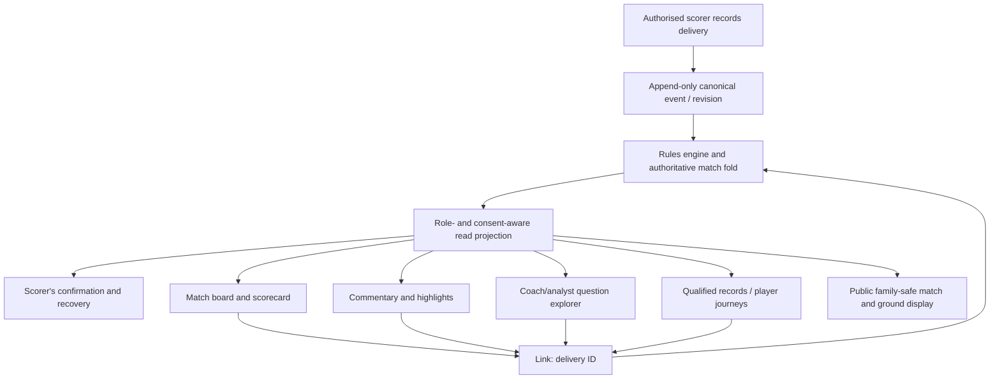

# ESPNcricinfo × SCRBRD — Full Competitive UI/UX Audit

**Date:** 23 October 2026  
**Scope:** Match discovery, live match centre, scorecard, ball-by-ball commentary, match statistics, visual analytics, records/Statsguru, player identity, content, notifications, responsive experience, accessibility, and applicability to SCRBRD School Sports OS.  
**Audience:** SCRBRD founder, UX/design, engineering, data/analytics, school pilot and QA teams.  
**Decision:** Make SCRBRD a *better operating system for school cricket*, not a smaller ESPNcricinfo.

> **Evidence limitation.** The live main ESPNcricinfo website was not available for an authenticated, interactive browser-and-screen-reader audit during this review. Current primary product listings and portions of Statsguru were accessible; independent screenshots and reviews add context. The SCRBRD source files were reviewed on GitHub's `main` branch, but the SCRBRD app was **not** run or visually verified as part of this review. Consequently, this document is an **evidence-led competitive product review and code-informed gap assessment**. It is **not** a verified, screen-by-screen live usability, accessibility or network-performance audit of either application.

## 1. Executive findings

**Overall:** ESPNcricinfo succeeds because it serves a series of distinct user needs within a coherent cricket-data universe: what is happening now, what happened, why it matters, who performed, and how that performance compares over time. Its most reusable principle is **progressive depth around a persistent match truth**. Its prominent weakness, reported by some current users, is interruption and clutter in high-frequency score-checking journeys. [S1] [S2] [S3]

**SCRBRD's opportunity:** Start with the real-world job, then expose appropriate data depth:

1. **Scorer:** Enter the event rapidly, confidently, and recover if wrong or offline.
2. **Spectator/parent:** Understand a score or a result without a login maze or having to interpret five charts.
3. **Coach/captain:** Turn match data into the next decision, grounded in the captured evidence.
4. **Analyst:** Navigate from a trend → filtered deliveries → reconciled scorecard → match context.
5. **Sportsmaster/administrator:** Understand what needs attention across fixtures, roles, officials, compliance and transport—not necessarily analyse strike rates.
6. **Player:** See development in context and appropriate, positively framed recognition, not reductive public rankings of children.

**Critical correction to a copycat strategy:** A source inspection shows SCRBRD **already has** Summary, Scorecard, Commentary, Partnerships, Analytics and Match details tabs; batting/bowling and worm/Manhattan charts; wagon wheel/heat map/spider; player and match comparisons; and role-appropriate privacy gating. The immediate need is **to unify, refine, verify and make these easier to discover and act upon**—not to rebuild them merely because ESPNcricinfo has equivalent labels. [G1–G8]

## 2. Method, confidence and evidence

| Evidence type | What is supportable | Confidence | Exclusions |
|---|---|---|---|
| Cricinfo and Apple/Google product listings | Officially offered features: scores, commentary, notifications, news, video, match coverage, stated update focus on clarity/speed | High for advertised functionality, not performance | Do not infer live refresh times, architecture or achieved speed |
| Statsguru/records pages | Stats categories, navigational grouping, filters and view types shown in accessible/cached pages | High for present primary records page; medium for older cached advanced form | Some deep Statsguru endpoints show maintenance or older crawls |
| Independent match centre screenshots / reviews | Visible arrangement at date of capture; reported strengths/frustrations | Medium for visible screenshots, low/medium for generality of reviews | Never represent dated promotional or third-party images as fresh browser captures |
| SCRBRD `main` source and specs | Existence of components, their apparent code behaviour, documented design intent | High for code existence, medium for runtime efficacy | Not equivalent to an end-to-end tested live flow |
| Competitive recommendations | Design hypotheses derived from user jobs and evidence | Hypotheses awaiting pilot validation | Not confirmed user behaviour or quantified gains |

**Desktop/mobile:** Desktop match centre layout and tablet examples are visible in third-party screenshots, but touch interactions, scroll states, keyboard flow, notifications and live render fidelity were not witnessed firsthand. No device-lab, network trace, automated audit or assistive-technology run was executed.

## 3. The information architecture lesson

ESPNcricinfo is designed around a broad public cricket audience: scores, fixtures, results, competitions, teams, news, video, statistics, records and historical archives. This breadth provides many entry points but risks diluting the highest-frequency task—**checking the score**. Statsguru is structurally separate but deep. [S1] [S4]

SCRBRD should expose three navigational layers, not one giant menu of 30 modules:

- **Global/context:** My school / my teams / fixtures / competitions / people, with role-gated management modules.
- **Match context:** Live/Overview → Scorecard → Commentary → Insights → Details; secondary areas such as Partnerships, Officials, Playing conditions and Corrections accessible in-context.
- **Intelligence context:** Player/Team performance → question → filters → results → individual deliveries → full match source.

**Recommended mobile navigation:** Four or five persistent high-frequency destinations selected by role, plus 'More' for remaining tools. An active match should be at most one obvious tap from the role's home. A scorer's match should offer an explicit **Enter scoring** action only when authorised; reading a match must never silently transfer the user into edit/scoring state.

**Discoverability risk in current SCRBRD:** `MatchView.jsx` defines six primary tabs and can add coach/captain context. Six or more equal-weight items are difficult to present as persistent horizontal options on a narrow phone. Retain the information but design a carefully prioritised tab system, with primary tabs and a 'More insights' entry. This is a **source-informed design risk**, not a verified on-device failure. [G1]

## 4. Surface-by-surface teardown and SCRBRD actions

### 4.1 Live score discovery and fixture index

**What to learn:** Scores and fixture/results access are top-level, recurrent tasks. A match list benefits from one glanceable status per row: live, interval, innings break, delayed, stumps, completed; teams, score, overs and one situation sentence. [S1] [S4]

**SCRBRD direction:** School-first fixture discovery rather than global cricket clutter. Filters for my school, team, division, competition, date, live/completed. Show school colours as accents but preserve semantic status colours. Persist last selected school/team. A parent should find a specific U13A fixture without scanning university, international and unrelated sport contexts.

**Important constraint:** A public school directory must never become an unrestricted directory of minors. Child names/photos and cross-match histories require explicit role/consent and server-side policy.

**Acceptance:** A parent can open the relevant U13A live fixture from a shared safe link without authentication when the match is published, and sees only the permitted projection; no sensitive identity is embedded in cached payloads.

### 4.2 Match Centre: the scoreboard as permanent truth

**What to learn:** The match centre is the product's central anchor. The score and match phase should remain understandable while users switch between commentary and analysis. A third-party image captures a live match summary, over strip, current batting/bowling figures, commentary, scoring breakdown and worm in the same view. [S6]

**SCRBRD direction:** Keep the persistent black `Board` (already a core design-system component). Header: full team names where possible, shortened where necessary; batting team's score, legal overs, previous innings/target, batter and bowler, last six balls, partnership, live/paused/final state and ‘last updated’. When chasing, use human language: 'Need 35 from 38 balls'. Ground displays can use a richer broadcast scene but **must not hide the score** while rotating insight panels. [G2] [G9]

**Interaction:** score → tap batter name → authorised player summary; tap a wicket chip → delivery and scorecard context; tap over strip → that over's commentary; tap the run-rate sparkline → filtered analytics. Preserve original scroll/selection when returning.

**Avoid:** forcing a scoreboard visitor through home cards, unrelated content, sponsorship, animated intro, login or advertising.

### 4.3 Scorecard: dense yet legible

**What to learn:** Cricinfo's scorecards use an established cricket vocabulary: R/B/4s/6s/SR for batting, O/M/R/W/Econ for bowling, dismissals, extras, fall of wickets, target, innings toggles. This recognisable format reduces learning effort for experienced users. [S7]

**SCRBRD status:** Code already supports innings toggles, dismissal descriptions, not-out batters, extras, bowling/FOW, and expandable batter rows with run breakdown and wagon wheel for an authorised reader. [G3]

**Actions:** (a) fix the scorecard header on mobile and provide accessible column explanations; (b) keep figures right-aligned and tabular; (c) show a clear row-level chevron / action; (d) keep the score summary visible on scroll; (e) when a person taps a wicket or scorer's correction, deep-link to exact inning and ball; (f) provide 'why this total?' including extras and legal-ball rules; (g) preserve print/export accuracy and show revision/time on exports.

**Accessibility:** Tables need appropriate column/row semantics, visible focus, meaningful screen reader order and horizontal scroll cue where necessary. Visual equivalence does not prove semantic completeness.

### 4.4 Commentary: a delivery-to-story index

**What to learn:** Ball-by-ball commentary acts both as live storytelling and an auditable chronology. Score chips and over dividers make long feeds scanable. A captured historical example shows a large 'event' column alongside granular delivery text. [S8]

**SCRBRD status:** Shared deterministic generator, newest-first over groups, commentary by delivery, incremental earlier-over reveal. It explicitly refuses to invent commentary where a demo match has no log. [G4]

**Actions:** Add filters 'All', 'Wickets', 'Boundaries', 'Extras' and 'Key moments'; innings and over jump; pinned over summary; locate a delivery by over.ball; tap opens contextual ball details and optional plotted shot. Search and filters should operate on the same authoritative event IDs as scorecard and wagon wheel, not separate approximated data.

**Accuracy:** Never claim ball speed, swing, exact distance, launch angle or field placement unless recorded or measured. Separate 'Scorer entered' from 'System calculated' and 'Not recorded'. An AI-generated colour-commentary feature, if ever added, must be clearly labelled and must never alter canonical score data.

### 4.5 Charts: more important than the chart library is the question

**What to learn:** An over-by-over worm and categorical run charts communicate trajectory and momentum; shot placement helps explain style, but the value comes from **access to the deliveries behind the shape**. [S6] [S9]

**SCRBRD status:** Worm, Manhattan, batters' impact, bowling economy, wagon wheel, heat map, spider and batter/bowler filters already exist in `AnalyticsTab` and `WagonAnalysisPanel`. [G5]

**Actions:** For every chart: state exactly what it measures; display the base sample and time/format scope; use accessible legend; on selecting data point filter the commentary/scorecard to its constituent ball(s). Enable side-by-side comparisons only where cohorts are compatible, sample sizes sufficient and access policy permits. Allow a compact chart view for spectators and expert breakdown for coaches.

**Data quality:** Shot sectors unavailable for some balls? Show 'Shots captured for 43 of 82 balls (52%)' instead of presenting a partial wagon wheel as a complete batting picture. Shot geography should respect left/right-handed transforms, striker identity, bowler variation and corrections. Don't equate scorer-drawn estimated distance with measured ball distance.

### 4.6 Statsguru, records and query design

**What to learn:** Statsguru distinguishes batting, bowling, fielding, all-round, partnerships, team and aggregate records; provides filters around match category, team, opposition, location, date, season and result, then multiple groupings and tabular outputs. This is the strongest analytic lesson. [S4] [S5]

**Counterpoint:** A long, dense form-based filter experience is not appropriate for a parent or 12-year-old scorer. We should copy the *power of analytical composition*, not necessarily the old filter UI.

**SCRBRD direction:** An **Analytics Explorer** with guided questions ('How did our U15A top order perform in the powerplay this season?', 'Where did my team concede boundaries?', 'Which bowlers have the best economy after at least 36 balls?') turns into visible, reversible filter chips: school, side, division, competition, season, format, phase, batting/bowling, opponent, ground, venue/weather data coverage, eligible fixture classes. Show result table plus chart, and retain a clear 'View deliveries' route.

**Saved views and safe links:** Coach can save 'Opposition preparation — U15A — T20 — last two seasons' without widening permissions; exported reports record query filters, data revision and generated time. Never claim a stored query confers access to a pupil's hidden health or cross-school records.

**Qualifications:** For youth records, explicitly delimit school, fixture class (competitive vs friendly vs inter-house), format, division, season, data coverage and eligibility minimum. For strike/economy rankings show denominators, never `—` as `0`. [G10]

### 4.7 Player profile: progression, not a miniature professional celebrity page

**What to learn:** Public cricket products make players recognisable through a biography/profile plus cross-format stats, recent matches, records and career history. Professional identity and long-term continuity are central product benefits. [S1]

**SCRBRD direction:** Treat the player as a **longitudinal development passport** with respectful visibility: latest result, recent innings or spells, season trend, best verified achievements, coach-approved development milestones and relevant historical team memberships. Make source coverage and coach verification visible. Allow a contextual path from the scorecard to the correct authorised profile.

**Privacy:** Parents access only linked children; coaches see assigned squads; pupils see own developmental view; public users see only the school-authorised, child-safe match projection. No automatic public youth leaderboards, sensitive notes, medical information, disciplinary incidents or unconsented photography.

### 4.8 Competition hubs and school identity

**What to learn:** The professional product groups matches by competition/series and preserves fixture, standings and historical results within that hierarchy. [S1] [S4]

**SCRBRD direction:** Each school's verified identity supplies team colours, logos, year/age-group, season and historical names. Competition pages should show upcoming fixtures, live matches, results, log/standings, bracket and eligibility. Inter-house, friendlies and competitive matches must not be silently mixed for records. Hierarchy: **School → Season → Competition → Division → Team → Fixture → Delivery** with shortcuts back to each parent object.

**Brand system:** Team colour belongs to identity and chart legends, while alert/sync/critical colour stays semantic. Use tested on-colour contrast, avoid gradients that obscure figures or make teams visually indistinguishable.

### 4.9 Content, highlights and emotional moments

**What to learn:** Cricinfo's news, analysis, match reports and video make match-following more than checking numbers. Those editorial surfaces create reasons to return. [S1] [S2]

**SCRBRD direction:** Keep match-critical views free of distracting media. Add opt-in match stories, meaningful highlights, a verified recap and shareable result cards. Support polished micro-animations for 4, 6, wicket, milestones and result **on spectator surfaces**; make the scorer's response immediate and non-blocking. Respect `prefers-reduced-motion` and never auto-trigger repeated ceremony on page refresh. [G2] [G9]

**Avoid:** claiming video highlights exist because there is a commentary feed; representing AI synthesis as verified narrative; publishing unauthorised pupil photos or recordings.

### 4.10 Notifications and favourites

**What to learn:** Live match notifications are a stated Cricinfo app function. User reviews report varied experiences with the mobile app, including frustration when interruptions distract from score checking. These are observations about reviewer experience, not controlled measurements. [S2] [S3]

**SCRBRD direction:** Follow school/team/fixture; choose reminders for start, toss, wicket, innings break, final result and schedule changes, appropriate to each role. Surface 'updated at' and delivery freshness clearly. Batch low-importance notices. Scorers should not receive visual overlays that block inputs. Parents should not be alerted about other children without permission.

### 4.11 Visual hierarchy and premium sports aesthetic

**Current code design system:** `Daylight`/`Floodlit`, black scoreboard, lime accent, Syne headings, DM Sans reading text, DM Mono tabular figures, line icons, a defined motion scale, and accessibility intentions. [G2] [G6]

**Recommendations:**

- **Layer 1 / persistent facts:** black board, large white mono score, restrained lime live/action state, team colour on appropriate identity elements.
- **Layer 2 / actionable intelligence:** clean bento-like analysis panels, contextual over strips, rates, mini-charts, team-colour charts with labelled legends.
- **Layer 3 / atmosphere:** cricket photography, pitch textures, stadium-depth lighting, cinematic transitions and broadcast-style animation *only* where it improves narrative and does not compete with data or disrupt operation.
- **Visual tokens:** `team.primary`, `team.secondary`, `team.gradient`, `team.onPrimary`, `team.onDark`, `role.figure`, `figure.tabular`, `state.live`, `state.saved`, `state.held`, `state.failed`, `motion.scoreFlip`, `motion.eventBeat` plus colour-vision-safe chart variants.
- **Rule:** each colour needs a job; no rainbow KPI tiles. A field graphic should look recognisably cricket-specific but remain readable on a cheap Android handset outside.

**Concrete code inspection item:** `AnalyticsView.jsx` still includes hard-coded 8px, 9px and 10px text in a locally built bar chart. The design specification's minimum is 12px, so this needs a repo-level/static and rendered audit. This is a **source-observed inconsistency**, not a claim of tested visibility on the current release. [G7]

### 4.12 Responsive, offline and accessibility risks

**Responsive design hypothesis:** a phone match viewer's information order should be score → match situation → who is batting/bowling → over summary → selected content. Desktop can add side rails for context. Tablet scorer may provide larger targets and a visible field map; scorer UI is not merely a smaller Match Centre.

**Offline/poor signal:** SCRBRD is the *source of truth* for school fixtures; a scorer recording without coverage must see local, queued and server-accepted state separately. Never render 'saved' when the event only lives on device. Corrections and sync conflicts need explicit resolution and a preserved audit trail. ESPNcricinfo should not be the model for event-authoring latency.

**Accessibility checks required:** minimum 44×44 touch targets for scorer keys, no critical read text smaller than 12px (prefer 15–16px for mobile body), AA contrast, 200% zoom/reflow, chart text equivalents, live announcements without chatter, keyboard navigation and focus, reduced motion, colour-vision modes, visible horizontal table scroll affordance, outdoor legibility. These are **test requirements, not claims of measured WCAG compliance or failure**. [S10] [G6]

## 5. SCRBRD code-grounded inventory

| Capability | Observed in repository | Status | Action |
|---|---|---|---|
| Six-section Match Centre | `MatchView.jsx` | Present in source | Reorder for mobile and test direct linking/back state |
| Scoreboard / over insights | `ui/board.jsx`, `tabs-core.jsx`, `scorer/boardData.js` | Present in source | Verify persistence, layout and scroll behaviour |
| Scorecard & expansion | `matchcentre/scorecard.jsx` | Present in source | Semantic table QA, delivery drill-down |
| Generated commentary | `tabs-core.jsx`, `@scrbrd/scoring/commentary` | Present in source | Add filters, over jump and anchored links |
| Partnerships | `tabs-core.jsx` | Present in source | Chart/scorecard cross-navigation |
| Match analytics suite | `matchcentre/tabs.jsx`, `scorer/charts.jsx` | Present in source | Normalize labels, denominators, drill-down |
| Detailed wagon analysis | `scorer/wagonAnalysisPanel.jsx` | Present in source | Coverage indicator and compare flow |
| Career/season/team comparisons | `AnalyticsView.jsx`, `compare.jsx` | Present in source | Better information architecture and guided queries |
| Metric provenance | `ui/sourceLine.jsx` | Present in source | Enforce consistent coverage labels |
| Scorer basic + detailed | `scorer/pad.jsx` | Present in source | First-use tests, measure speed versus capture depth |
| Revisions and correction UI | `MatchView.jsx`, `matchcentre/corrected.jsx` and `corrections.jsx` | Present in source | Verify replay, invalidation and cache freshness end-to-end |
| Child-safe public data | `docs/policy/PUBLIC_DATA.md` and public projection architecture | Documented/code-referenced | Full API and cache isolation tests |
| Recognition/records | `docs/design/RECOGNITION_spec_v0.2.md` | Spec confirmed; current implementation not assessed | Build only on qualified authoritative evidence |
| Dual theme/typography | `design/tokens.js` | Present in source | Eliminate local small-font overrides, test outdoor |

The purpose of this inventory is to prevent duplicative feature-building. **Code existence is not a claim of a production-ready end-to-end flow.**

## 6. Three user journeys to build and test

### Journey A — Saturday parent on a phone

1. Open published fixture from school schedule or trusted link.
2. See both team scores, match state, target, overs and last update immediately.
3. Tap Scorecard; own child's permissible row is emphasised without disclosing extra data about peers.
4. Tap relevant innings/performance; inspect permitted charts and commentary.
5. Return with match location, selected innings and scroll position preserved.
6. Share child-safe scoreboard / result, with no hidden person details.

**Success:** No login for explicitly published, public-safe match; not more than one additional tap to the scorecard; no ID/PII in public API beyond the agreed projection; readable at 390px under daylight.

### Journey B — U13 volunteer scorer with intermittent reception

1. Authenticated authorised scorer sees correct match and side, gets toss / innings set-up.
2. New user selects Basic; expert can switch to Detailed without changing how a legal delivery is accounted for.
3. Record dot, single, wide, no ball, wicket (dismissal and who effected it), undo and changed bowler.
4. On lost signal, clear 'saved on this device — waiting to send' indicator; scorebook does not freeze.
5. Regain network, reconcile order and duplicates using event IDs; show 'sent' only after server acceptance.
6. Correct an earlier ball through appropriate controlled route; every reader eventually sees one revision.

**Success:** No lost, doubled or falsely acknowledged events; score remains visible; essential scoring never waits for three optional placement stages; data-quality coverage is honestly reported.

### Journey C — Coach preparing opposition analysis

1. Choose team, opponent, competition, format and season.
2. Ask a plain question: where were runs conceded in first six overs?
3. See a chart plus the exact denominator and coverage.
4. Tap segment to inspect actual logged deliveries and approved commentary.
5. Compare qualified same-format cohorts; notice low samples and corrections.
6. Save permitted view and later reopen with current authorised access.

**Success:** Every statistic is reproducible from the canonical match events; no leakage of minors' health/availability, anonymous peers or opposing pupils outside authorised scope.

## 7. Proposed match centre layout

Illustrative data only; **not a real school result**. This is a textual hierarchy, not a verified render.

```text
LIVE · Westville U15A v DHS U15A · 20 overs

DHS                        142/7 (20.0)
WESTVILLE                  108/3 (13.4)

NEED 35 FROM 38 BALLS       RRR 5.53

BATTERS                 BOWLER
M Pillay       31 (25)   S Naidoo   2/24 (3.4)
T Singh        18 (16)   Partnership  42 (31)

THIS OVER    1 · 0 · 4 · 1
Updated 4 s ago  ·  Live  ·  Connected

[Overview] [Scorecard] [Commentary] [Insights ▾]

LIVE CONTEXT
Target 143     CRR 7.90     RRR 5.53
Run-rate trajectory (tap for deliveries)
This innings' last 6 overs / bowling / shot areas
```

The fictional score and rate calculation are internally consistent: 13.4 overs is 82 legal balls; 38 remain in a 120-ball innings; a target of 143 from 108 needs 35 runs; RRR is 35×6/38 ≈ 5.53. **Illustrative player figures in the mock hierarchy are not a complete scorecard and should not be used as numerical validation.**

On mobile, only a small number of panels should be simultaneously open. On desktop, the live score remains in an anchored primary column; scorecard/over feed and supplemental insight can form a split layout.

## 8. Priority backlog: action, rationale, acceptance

Priority is based on pilot risk, expected task frequency and dependency—not speculative effort scoring. `P0` means pilot-critical, `P1` near-term differentiator, `P2` exploratory. Existing capability areas should be **refined and tested**, not rebuilt.

| ID | Priority | Recommendation | Type | Acceptance / evidence |
|---|---|---|---|---|
| UX-01 | P0 | Fixed match truth and phase-aware summary across all match surfaces | Refine/QA | Score, overs, target, match state and update time agree per revision and permission scope |
| UX-02 | P0 | Test scorer Basic vs Detailed onboarding | User research + refinement | First-time volunteers complete common deliveries, wickets, changes and undo accurately; coverage trade-off measured |
| UX-03 | P0 | Scorecard ↔ commentary exact-ball navigation | Interaction build | Delivery/event ID anchors correct innings, ball and revised event; back preserves state |
| UX-04 | P0 | Offline/sync truth and correction feedback | Resilience QA | Local/held/sent/rejected state distinguishable; no duplicate events; corrected views reconcile |
| UX-05 | P0 | Mobile legibility & outdoor audit | Accessibility remediation | 320/360/390px no clipped core score; appropriate text/touch floors; keyboard/voice testing |
| UX-06 | P0 | Public minor-data privacy regression suite | Security/QA | Published score safe; restricted names, photos and health not leaked through drill-down, cache or shared URL |
| UX-07 | P1 | Match tabs prioritised by role and context | IA design | Common role tasks found in ≤2 taps from fixture; existing sections retained |
| UX-08 | P1 | Commentary filters and over-jump | Feature refinement | Filter wicket, boundary, extras, moments; matching scorecard and event links |
| UX-09 | P1 | Source/denominator/coverage everywhere | Analytics QA | Partial/missing placements, unknown and small samples labelled rather than silently omitted |
| UX-10 | P1 | Chart-to-delivery drill-down | Analytics interaction | Click/keyboard select interval or area returns canonical filtered deliveries with source context |
| UX-11 | P1 | Guided Statsguru-inspired Explorer | New information layer | Clear school/team/format/season chips; saved views preserve permissions; rate minimums enforced |
| UX-12 | P1 | Player development passport | IA/presentation refinement | Latest, season, historical and verified milestones viewable within scoped access |
| UX-13 | P1 | Team colour tokens with accessible variants | Design system | School colours readable in Daylight/Floodlit and colour-vision modes; semantic alerts unchanged |
| UX-14 | P1 | Responsive scorecard/data table component | Component consolidation | Correct cricket columns, high readability, horizontal-scroll hints and screen-reader semantics |
| UX-15 | P2 | Role-aware favourites and notifications | Product iteration | School/team follow, match start/result preferences, permission-safe alerts |
| UX-16 | P2 | Editorial recaps and broadcast outputs | Visual enhancement | Data-proven statements, safe media consent and no scorers' input interruption |
| UX-17 | P2 | Natural-language stat search | Research spike | Results show filters, source, denominator and links; hallucinated metrics blocked |
| UX-18 | P2 | Prediction experimentation | Research spike | Calibration proven on sufficient comparable school data, uncertainty always shown; otherwise no % |

### Roll-out sequence

**Sprint 0 — test the baseline:** instrument the current Match Centre, Scorecard, Analytics and scorer; capture 360/390/768/1440px screenshots in both themes; measure core tasks; test weak network, event revision and school/role isolation; audit local fonts and ChartTable semantics. Do not redesign all 30 modules upfront.

**Sprint 1 — make match following flawless:** UX-01, 03, 04, 05, 06, 07 and 14. Treat parent spectator and scorer as separate acceptance walks.

**Sprint 2 — make existing data explorable:** UX-08, 09, 10, 13, with coverage and cross-panel navigation; preserve all existing calculations and privacy gates.

**Sprint 3 — build differentiation after pilot evidence:** UX-11, UX-12 and select safe role-context notifications, then evaluate advanced features according to captured school data volume and actual weekly usage.

## 9. Metrics and testing protocol

This review does not invent current baseline scores. Set targets and measure them:

| User need | Suggested test | Working target (to validate) |
|---|---|---|
| Find live score | Parent opens a published fixture on a budget Android handset | Team score + match phase recognisable within ~3 seconds once page loads |
| See personal context | Parent navigates to their linked pupil's permitted scorecard row | No more than two deliberate taps after opening fixture |
| Record simple ball | Novice scores first over, including extras, with coaching absent | No missed, duplicated or silently changed events; track tap count and completion time |
| Correct two balls back | Authorised correction exercise with live reader open | One reconciled scorecard and clearly described revision; no permanent ghost milestone |
| Contextualise chart | Coach answers a question from a 10-over chart segment | 100% of represented runs traceable to authorised delivery IDs; source/sample visible |
| Privacy | Parent/public/coach roles try direct URL, API replay, chart and export | No unauthorised PII/health; permissions enforced server-side |
| Accessibility | Keyboard, screen reader, 200% zoom, high contrast, reduced motion | Issue findings remediated to agreed WCAG 2.2 AA interpretation; screen reader can reconstruct score |
| Stability | Network loss, 2G/3G throttling, focus switch, refresh, stale revision | Queued local entries preserved; honest live/sync state; no block on basic scoring |
| Rendering | Real-world low-end devices and core routes | Monitor p75 LCP, INP and CLS against practical targets (e.g. ≤2.5s, ≤200ms, ≤0.1 respectively) |

**Research sample suggestion:** 6–8 pupils/volunteer scorers across age and experience; 5–6 parents; 4–6 coaches; 2–3 sports administrators; accessibility specialist(s). A small sample reveals major task obstacles, not statistically generalisable conversion improvements. Include sunlit boundary, patchy mobile reception, one-handed use and a full 20-over rehearsal.

## 10. What not to copy, and what to challenge

1. **Global content breadth.** Cricket media needs a giant content taxonomy. A school-scoped user wants their fixture first.
2. **Intrusive engagement mechanics.** Some 2026 users report full-screen interstitial ads during score checks [S3]; do not allow ads, brand experiences or celebratory overlays to block core work.
3. **Dense filter forms.** Use contextual, guided analytical questions that can expand into expert controls. Preserve depth, lose the initial friction.
4. **Professional player-leaderboard logic.** School-age performance is not reliably comparable across age groups, sample sizes, fixture classes and availability; ethical child-safe defaults matter.
5. **Unlabelled predictive certainty.** An '89% win chance' is not evidence if the model is uncalibrated for U13 cricket, non-standard over lengths, unavailable batting orders and under-sampled venues.
6. **Visualising unrecorded details.** Cloud cover does not prove swing, a wagon wheel drawn by a scorer does not prove precise metres, and a rate based on five balls should not be framed as a stable ability measure.
7. **A single role-neutral navigation system.** The scorer and parent need fundamentally different tools, even when looking at the same delivery log.

## 11. The North Star: one canonical cricket event, many useful experiences



This is a conceptual product architecture, not a claim about ESPNcricinfo's internal implementation. The SCRBRD code already approaches this through an append-only event log, `deriveMatch` and redacted public projections. Preserve that advantage instead of introducing separately editable per-screen counters. [G1] [G11]

**Differentiating idea:** An insight should be **auditable**. If a coach clicks '65% of boundaries through the off-side', SCRBRD should reveal exactly which 4s and 6s were captured, the relevant batting context, who recorded placement, the definition used, what proportion of all balls had placement data, and whether revisions changed the result. That is more defensible than simply producing another colourful chart.

## 12. Open verification items

These require a live device/browser investigation and should not be marked as fact until completed:

- Current ESPNcricinfo desktop and Android/iOS screen-by-screen inventory with captured viewport widths, scroll/focus states, filters and back navigation.
- Actual live scoreboard stickiness, ad appearance frequency, keyboard accessibility, screen-reader announcements and rendering performance.
- Actual update transport, caching and response timings for Cricinfo (do not infer WebSockets vs polling).
- SCRBRD main-branch production behaviour and pilot real-school walkthroughs; whether repository components described above are mounted, usable and data-backed for each assigned role.
- Actual adoption, completion time and data-depth trade-offs of Basic vs Detailed scoring.
- POPIA consent edge cases, public result exports, role transitions and opposition data-retention windows.

## 13. Source register

### Primary and third-party Cricinfo evidence

- **[S1]** Official iOS App Store description, features and current version history: https://apps.apple.com/us/app/cricinfo-live-cricket-scores/id417408017
- **[S2]** Official Google Play listing and dated user reviews: https://play.google.com/store/apps/details?id=com.july.cricinfo
- **[S3]** App Store reviews with dated advertising/interaction complaints (self-reported): https://apps.apple.com/us/app/cricinfo-live-cricket-scores/id417408017?platform=iphone&see-all=reviews
- **[S4]** Cricinfo Statsguru home and categories: https://stats.cricinfo.com/blank/engine/stats/index.html ; older accessible detailed batting filters: https://stats.espncricinfo.com/ci/engine/stats/index.html?class=1%3Bdnp=0%3Btype=batting
- **[S5]** ESPNcricinfo older indexed Statsguru advanced team-record filters; date and maintenance caveat: https://stats.espncricinfo.com/ci/engine/stats/index.html?class=1%3Bfilter=advanced%3Bhost=3%3Btype=team
- **[S6]** Independent match-centre comparative screenshot and commentary on trade-offs (9 Nov 2025): https://prodlab.substack.com/p/bringing-cricket-to-the-people-cricbuzz
- **[S7]** Third-party Android promotional screenshot of batting scorecard and tabs: https://espncricinfo.en.aptoide.com/app
- **[S8]** Historical commentary screenshot in academic article; presentation example only, not current state: https://www.techscience.com/iasc/v36n3/51905/html
- **[S9]** Cricinfo records taxonomy (live accessible): https://phone.stats.espncricinfo.com/ci/content/records/index.html
- **[S10]** WCAG 2.2 standard and understanding target size: https://www.w3.org/TR/WCAG22/ ; performance reference https://web.dev/articles/inp

### SCRBRD source and design evidence — `iamkameel/SCRBRD_OS`, `main`

- **[G1]** Match context, tabs, log, correction policy: https://github.com/iamkameel/SCRBRD_OS/blob/main/apps/web/src/views/matchcentre/MatchView.jsx
- **[G2]** Design direction and live board: https://github.com/iamkameel/SCRBRD_OS/blob/main/docs/redesign/DESIGN_DIRECTION.md
- **[G3]** Scorecard: https://github.com/iamkameel/SCRBRD_OS/blob/main/apps/web/src/views/matchcentre/scorecard.jsx
- **[G4]** Summary, commentary and partnerships: https://github.com/iamkameel/SCRBRD_OS/blob/main/apps/web/src/views/matchcentre/tabs-core.jsx
- **[G5]** Match analytics and wagon analysis: https://github.com/iamkameel/SCRBRD_OS/blob/main/apps/web/src/views/matchcentre/tabs.jsx ; https://github.com/iamkameel/SCRBRD_OS/blob/main/apps/web/src/scorer/wagonAnalysisPanel.jsx
- **[G6]** Design tokens: https://github.com/iamkameel/SCRBRD_OS/blob/main/apps/web/src/design/tokens.js
- **[G7]** Analytics hard-coded local chart type scales and views: https://github.com/iamkameel/SCRBRD_OS/blob/main/apps/web/src/views/AnalyticsView.jsx
- **[G8]** Analytics comparison and data provenance: https://github.com/iamkameel/SCRBRD_OS/blob/main/apps/web/src/views/compare.jsx ; https://github.com/iamkameel/SCRBRD_OS/blob/main/apps/web/src/ui/sourceLine.jsx
- **[G9]** Scorer/scoreboard distinction, spectator moment feedback: https://github.com/iamkameel/SCRBRD_OS/blob/main/apps/web/src/scorer/pad.jsx ; https://github.com/iamkameel/SCRBRD_OS/blob/main/docs/design/SCRBRD-133_immersive_match_centre.md
- **[G10]** Qualified records spec and child/privacy concerns: https://github.com/iamkameel/SCRBRD_OS/blob/main/docs/design/RECOGNITION_spec_v0.2.md ; https://github.com/iamkameel/SCRBRD_OS/blob/main/docs/design/GA-I24-I25_compare_and_combine.md
- **[G11]** Append-only corrections/revisions (spec, not implementation sign-off): https://github.com/iamkameel/SCRBRD_OS/blob/main/docs/design/GA-I36_corrections_everywhere.md

---

## Closing recommendation

**Approve a Match-Centre-and-Scorer experience audit before a full visual redesign.** Make the score unmistakable, the next action obvious, every chart traceable and every role's permissions predictable. Use ESPNcricinfo as a benchmark for information depth, not as an end-state visual template. The winning SCRBRD experience is **cricket intelligence grounded in accurate first-party school data**, delivered through an interface a pupil can score with and a coach can trust.
