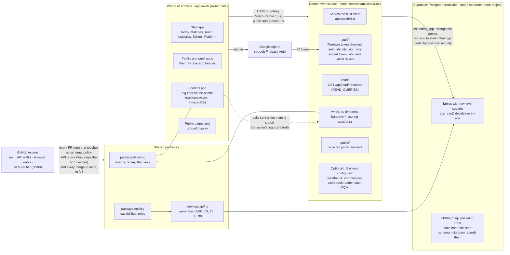
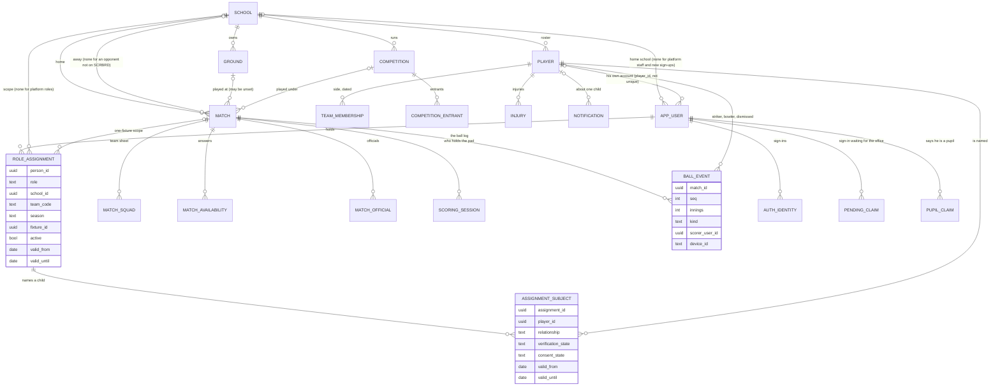
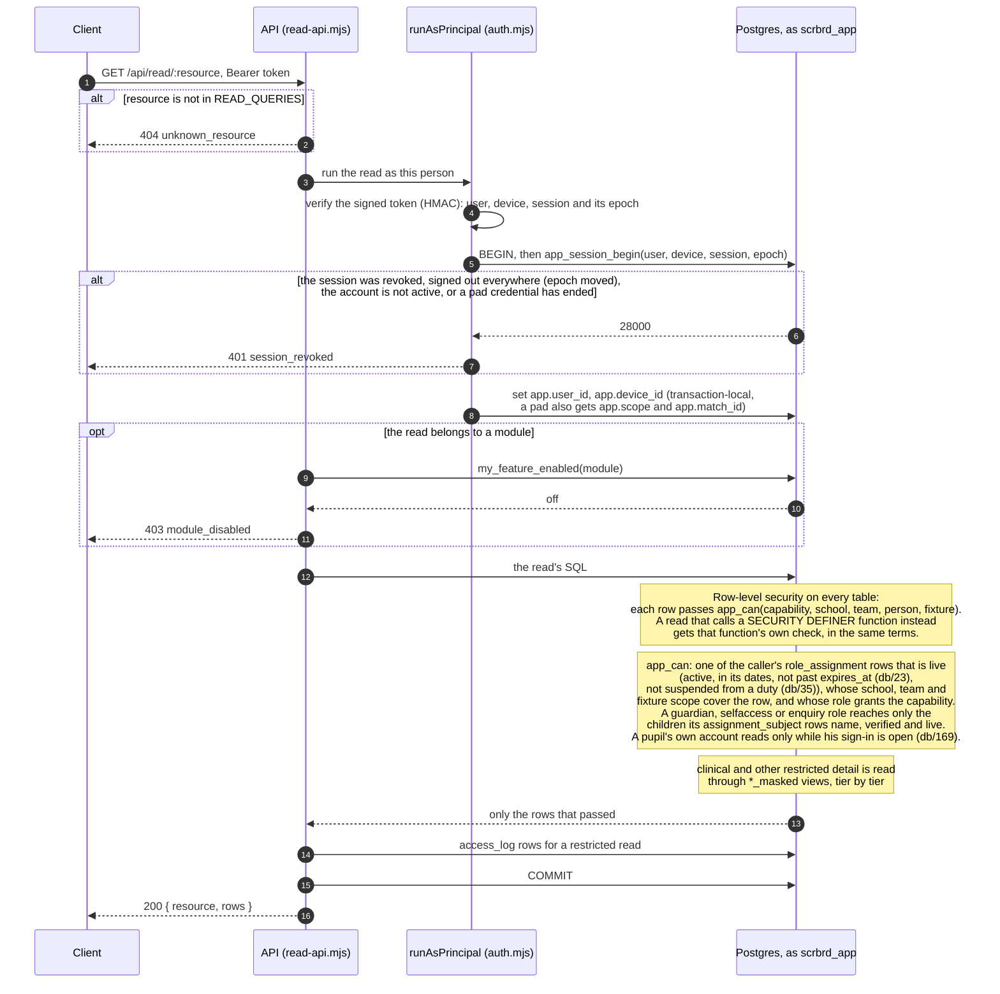

# SCRBRD OS: three diagrams

The system, the data model, and how a read is decided. Each was drawn from the code on `main` (28f08b63, 25 Nov 2026) and checked against it; the file each claim rests on is named under its diagram. When the code changes what a diagram shows, the diagram changes in the same PR.

---

## 1. The system

**Checked against:**
- `services/api/server.mjs`: it serves `apps/web/dist`, refuses to start for a superuser or BYPASSRLS login (lines 190-205), and resolves push at boot.
- `services/api/realtime/realtime.mjs`: the hub is not mounted (8 Oct), so every screen polls.
- `services/api/auth/auth.mjs`: the token carries only who and which device.
- `services/api/auth/signin-api.mjs` and `db/81` `auth_identity_sign_in()`.
- `packages/sync/src` (`indexeddb-storage.mjs`, `sync-engine.mjs`).
- `services/api/rls` and the generated files named in CI's "RLS output is current" step.
- The Render startup log of 25 Nov: weather, AI and the scorebook reader are unconfigured on production.
- `.github/workflows/ci.yml`, the "What changed" job (#396): which paths make a PR run the RLS verifier; a push to main always runs it.

---

## 2. The data model (the core of 146 tables)

**Notes.**
- **There is no team table.** A side is a school plus a `team_code`, on `role_assignment`, `team_membership` and the match.
- **A link to a child is an `assignment_subject` row.** Access through it needs that row verified and live. A parent's terms agreement is kept on it (`consent_state`).
- **Optional keys are drawn as optional:** a person's home school, a role's school (platform roles have none), the away school (an opponent not on SCRBRD), the ground, a match's competition and a notice's child.
- **The ball log is append-only.** A correction is a new event, never an edit (`packages/scoring`).
- **Reads of restricted records write `access_log`.** The ball log's own audit is `scoring_audit`.

**Checked against:**
- the `REFERENCES` clauses in `db/00_schema_core.sql`, `db/02_schema_scoring.sql`, `db/08_schema_programme.sql`, `db/81` and `db/168`;
- `match.competition_id`, added later (`ALTER TABLE match ADD COLUMN competition_id … REFERENCES competition`);
- `app_user.player_id`, whose key is added after `player`.

---

## 3. How a read is decided

**Checked against:**
- `services/api/read/read-api.mjs`: `readResource()` covers the unknown-resource 404, the module gate through `my_feature_enabled` and the `logsItself` / `logsReads` options.
- `services/api/auth/auth.mjs`: `sessionConfigStatements()` and `runAsPrincipal()`.
- `db/85` `app_session_begin()`, raising 28000, which `auth.mjs` answers 401 `session_revoked`.
- `db/23` (`expires_at`) and `db/35` (a suspended duty grants nothing): the generated liveness rule.
- `db/01` `app_can()`, whose person-scoped arm is unchanged in its rules.
- db/169's re-emitted `app_can()`, `app_can_but_player()` and `is_family_of()`, which add `pupil_signin_open()`.
- The generated policies in `db/09`.
